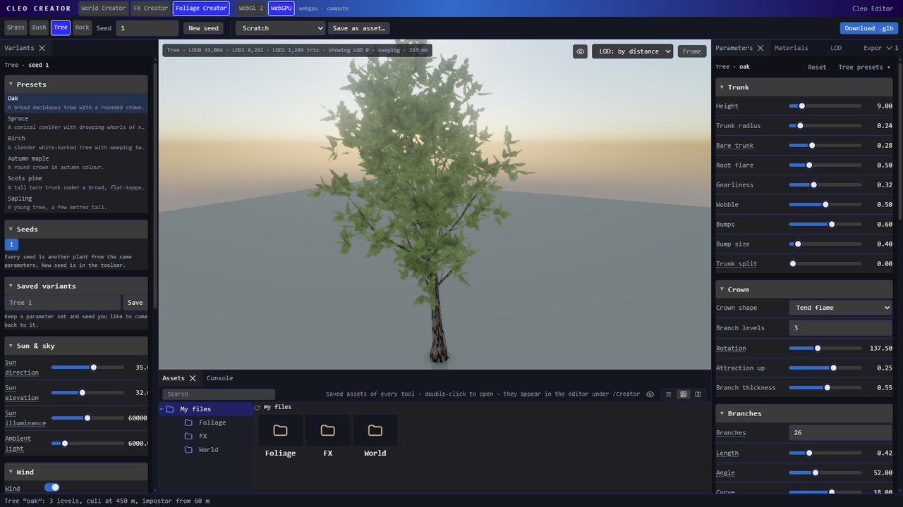
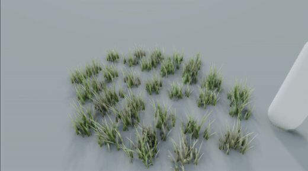

# Foliage Creator

Generate grass clumps, bushes, trees and rocks from parameters, each with its levels of detail and its
materials, and export them as glTF models ready for a foliage rule.

Pick **Grass**, **Bush**, **Tree** or **Rock** in the toolbar. Each kind keeps its own parameters, so switching
back and forth loses nothing. Every edit regenerates the asset in a background worker, and the
**Viewport** shows it as a real LOD group, switching levels by distance exactly as a game does. The
preview loads the same `.glb` files the export writes, through the Editor's own importer, so what you
see is what you import. Drag to orbit, right-drag to pan, scroll to move closer; **F** frames the asset.

The **Stage** menu top-right of the viewport sets what the preview shows and the light on it (see
[Stage](#stage)). The **LOD** menu beside it pins one level, or lets distance choose. The corner readout
gives each level's triangles and the level on screen.

The layout is the Creator's own (see [the Creator](index.md#layout)), without a left dock. The **right**
dock holds **Parameters** (the shape, with **Presets ▾** at its top), **Materials** (every material the
asset carries, in the Editor's material sections), **LOD** (the level ladder) and **Export** (texture sizes
and the embedded textures). **Download .glb** in the toolbar writes the files, named after the saved asset
(`untitled` while on Scratch).

Every asset is a pure function of its parameters and **Seed**. Random choices are keyed by what they
decide (this branch, this leaf), so changing one slider moves only what it touches.

## Seed

The toolbar's **Seed** is the current plant's seed. **▾** beside it lists the seeds tried this session:
click one to go back to it. **New seed** gives another plant from the same parameters.

A plant worth keeping is kept as a library asset: **Save as asset…** in the toolbar, then open it again
from **Assets**. (Variants saved in the browser by an older Creator moved into Assets ▸ `/Foliage` the
first time it opened.)

## Presets

**Parameters ▸ Presets ▾**: starting points for the current kind. A preset replaces the kind's parameters
and keeps the seed; the Parameters header shows the preset applied last.

## Stage

The **Stage** menu, top-right of the viewport: the preview's stage. None of it reaches the export.

**Show** — what the preview draws, and how:

| Row | Does |
|---|---|
| **Grid** | The floor grid. |
| **Floor** | The ground plane. |
| **Sky** | The sky behind the plant. |
| **Patch of clumps** | Grass only: a patch of clumps instead of one. |
| **Wind** | A wind on the stage, so the preview sways (see [Wind](#wind)). |
| **Walk-through** | Someone walks back and forth through the preview, so you can see how the plant gives way and springs back: the materials' **Interaction**. Draws the asset as a foliage layer too, with or without wind. |
| **Wireframe** | The triangles. Shown still, as nodes. |

**Sun** — **Direction** is the sun's compass direction, **Elevation** its height above the horizon. Low and
behind a plant shows its translucency.

### Light

| Field | Meaning |
|---|---|
| **Sun illuminance** | Sunlight in lux; 60 000–100 000 is a clear day. |
| **Ambient light** | The flat fill under the sky, in lux. |

### Wind

While **Wind** is on, the asset is drawn as a foliage layer, the path a game's foliage rules use, so its
foliage materials sway, vary and weather as they will in a level; with Wireframe on (which that path does
not draw) it is shown still, as nodes. The viewport's readout says which.

| Field | Meaning |
|---|---|
| **Preset** | Calm to Storm: strength and gusts as the engine's wind presets set them. |
| **Direction** | Where the wind blows toward, degrees counter-clockwise from +X. |
| **Strength** | How hard: multiplies every material's lean. |
| **Gust size** | The size of a gust, in metres. |
| **Gust speed** | How fast gusts travel. |

### Weather

The stage's weather, to see the materials' **Weather** settings at work.

| Field | Meaning |
|---|---|
| **Wetness** | How wet the stage is: leaves and blades darken, turn glossy and bow under the water. |
| **Snow** | How much snow lies on the plant: it settles on what faces up and weighs the plant down. |

## Clump

A grass clump is the unit a foliage rule scatters: one instance, many blades.

| Field | Meaning |
|---|---|
| **Blades** | Blades in the clump. Each is a few triangles. |
| **Clump radius** | How far from the centre blades grow. They are denser near the middle. |
| **Clump facing** | How much blades lean away from the clump's centre, as real clumps splay. |

## Blade

Each blade is a strip along a bent spine, tapering to its tip.

| Field | Meaning |
|---|---|
| **Height** | Average blade height. Blades near the clump's edge are shorter. |
| **Height variance** | How much heights vary, as a fraction. |
| **Width** | Blade width at the root. |
| **Taper** | How much of the width is gone at the tip; 1 is pointed. |
| **Bend** | How far the tip leans out, as a fraction of the height. |
| **Curvature** | How the bend is spread: 1 a straight lean, higher values droop near the tip. |
| **Tilt** | Random lean from vertical. |
| **Segments** | Spine segments per blade. More curve smoothly; each adds two triangles. |
| **Normal rounding** | How far normals turn across the blade, so a flat strip shades as a rounded blade. |

## Shape

A rock starts as a dense sphere, is carved, and is then reduced to its triangle budget.

| Field | Meaning |
|---|---|
| **Size** | The rock's diameter before proportions. |
| **Proportions** | Width, height and depth relative to the size. |
| **Detail** | Subdivisions of the sphere the noise carves. Higher keeps finer features through the reduction. |
| **Triangles** | LOD 0's triangle count after reduction. The silhouette survives far better than starting coarse. |

## Surface

| Field | Meaning |
|---|---|
| **Noise amount** | How far the surface is pushed in and out. |
| **Noise scale** | How many bumps across the rock. |
| **Sharpness** | Blend from rolling noise to sharp ridged crests. |
| **Cuts** | Planar fractures: flat broken faces where the rock split. |
| **Cut depth** | How deep each fracture bites. |
| **Strata** | Sedimentary layering, as terraces in the shape and bands in the colour. |
| **Strata frequency** | How many layers. |
| **Flatten bottom** | How much of the base is cut flat so the rock sits on the ground. |

## Blade texture

Grass: the blade texture, generated from these colours. The clump card LOD 2 shows is drawn from the
blades, so it follows. Edited in the **Materials** tab, under the Blades material.

| Field | Meaning |
|---|---|
| **Base colour** | The colour low on the blade. |
| **Tip colour** | The colour at the tip. |
| **Dryness** | The share of blades that are dry. |
| **Dry colour** | The dry blades' colour. |
| **Root shade** | Darkening at the root, standing in for the shadow inside the clump. |

## Rock texture

Rock: the albedo and normal map, baked into the rock's own six-chart layout. Edited in the **Materials**
tab.

| Field | Meaning |
|---|---|
| **Colour** | The stone's base colour. |
| **Colour variation** | Broad tonal patches across the stone. |
| **Edge wear** | Lighter, worn crests. |
| **Cavity dirt** | Darker hollows and base. |
| **Moss** | Moss on faces that look up. |
| **Moss colour** | The moss's colour. |
| **Bumpiness** | Strength of the baked normal map. |

## Stems

A bush is several stems rising from one root crown, each grown like a small tree (with the tree's
branching, leaves and bark) and leaning out from the centre. The outer stems lean furthest, which gives
the vase shape most shrubs have. Bushes have no collider and no impostor: they are walked through, and
culled before an impostor would pay.

| Field | Meaning |
|---|---|
| **Stems** | How many stems rise from the root crown. |
| **Spread** | The root crown's radius. |
| **Height** | Average stem height. Outer stems are a little shorter. |
| **Height variance** | How much stem heights vary. |
| **Lean** | How far the outer stems lean out from vertical. |
| **Stem radius** | A stem's radius at the ground. |
| **Bare stem** | Fraction of each stem with no branches. |
| **Gnarliness** | How much every stem wanders. |
| **Wobble** | A smooth sideways wander along the trunk (each branch level has its own), from coherent noise: long gentle bends, where Gnarliness gives short kinks. |
| **Bumps** | Burls, knots and vertical flutes on the trunk (each branch level has its own), pushed out of the bark surface in proportion to its radius. The same relief at every level of detail, and the bark's shading follows it. |
| **Bump size** | The size of one bump, in metres. |

## Trunk

| Field | Meaning |
|---|---|
| **Height** | The tree's height. |
| **Trunk radius** | Radius at the base, above the root flare. |
| **Bare trunk** | Fraction of the height with no branches. |
| **Root flare** | How much wider the base gets. |
| **Gnarliness** | How much every stem wanders. |
| **Wobble** | A smooth sideways wander along the trunk (each branch level has its own), from coherent noise: long gentle bends, where Gnarliness gives short kinks. |
| **Bumps** | Burls, knots and vertical flutes on the trunk (each branch level has its own), pushed out of the bark surface in proportion to its radius. The same relief at every level of detail, and the bark's shading follows it. |
| **Bump size** | The size of one bump, in metres. |
| **Trunk split** | Where the trunk forks into two leaders, as a fraction of the height; 0 never forks. |

## Crown

| Field | Meaning |
|---|---|
| **Crown shape** | The outline that sets first-level branch lengths up the trunk (Weber and Penn's shapes): conical for a spruce, spherical or tend-flame for a broadleaf, and so on. |
| **Branch levels** | How many levels of branching below the trunk. Each level multiplies the stem count. |
| **Rotation** | The turn between successive branches. 137.5° (the golden angle) never lines two up. |
| **Attraction up** | Stems bend toward the sky (positive) or droop (negative) as they grow. |
| **Branch thickness** | A branch's radius relative to its parent's at the fork. |

## Branches

First-level branches, along the trunk. The **Sub-branches** and **Twigs** sections set levels 2 and 3
with the same fields.

| Field | Meaning |
|---|---|
| **Branches** | How many: along the trunk for the first level, on each parent below that. |
| **Length** | Relative to the parent. First-level lengths also follow the crown shape. |
| **Angle** | The angle down from the parent's direction. |
| **Curve** | How much each branch bends along its length: positive up, negative down. |
| **Gnarliness** | The level's jitter, times the trunk's Gnarliness. |
| **Wobble** | A smooth wander along each branch of the level, with a quicker ripple on top so short branches are not ruler-straight. |
| **Bumps** | Knots, burls and lumps along each branch, at the branch's own scale (a few radii across, never trunk-sized). |
| **Kinks** | Up to three elbows per branch, where it turns 10–25° as if a side shoot had taken over. |

Every branch also swells into a collar where it leaves its parent, the bark ridge a real fork has.

## Sub-branches

Second-level branches, on each first-level branch. Fields as in [Branches](#branches).

## Twigs

Third-level branches. Fields as in [Branches](#branches).

## Leaves

Leaves are cards, each carrying a sprig of several leaves (or a brush of needles) from a generated
atlas: ten to twenty leaves for two triangles. Where they grow is here; how they look is the **Leaf
texture** in the Materials tab.

| Field | Meaning |
|---|---|
| **Leaf kind** | Broadleaf sprigs, needle brushes, or none. |
| **Cards per branch** | Cards on each end branch, plus one at its tip. |
| **Card size** | One card's size. |
| **Size variance** | How much card sizes vary. |
| **Leaf start** | How far along an end branch leaves begin. |
| **Normal bend** | How far card normals lean outward from the crown's centre, so the canopy shades as one volume instead of a scatter of flat cards. |
| **Fold** | Each card folds along its midline into a shallow V, each half shaded on its own, so leaves catch the light instead of reading as flat sheets. LOD 0 and 1; LOD 2 stays flat (2 triangles a card more on LOD 1). |
| **Curl** | Each card's tip curls back along its length. |
| **Segments** | Rows along each card (1–4). Every row folds, twists and ripples on its own, so a card bends instead of hinging once. LOD 0 uses them all, LOD 1 half, LOD 2 keeps flat cards; a card costs 2 triangles per row and column. |
| **Fold shape** | V crease along the midrib (2 columns), or cupped across the blade (4 columns). |
| **Twist** | The card's cross-section turns about its length, up to about 40° at the tip. |
| **Wave** | A ripple along the card. |
| **Jitter** | How differently each card folds, twists and ripples, so a crown is not one card repeated. |

## Leaf texture

Trees and bushes: the leaf (or needle) atlas, generated from these settings, and its normal map, drawn
with it: each leaf a gentle dome with its midrib and veins sunk in, each needle and twig a rounded ridge.
Edited in the **Materials** tab, under Leaves or Needles, where either texture can be replaced by an
image (or a whole texture set).

| Field | Meaning |
|---|---|
| **Leaf shape** | The broadleaf outline. |
| **Leaf colour** | The leaves' base colour. |
| **Colour variation** | Variation in hue and value between leaves. |
| **Autumn** | Blend toward autumn reds, oranges and yellows. |

## Bark texture

A tiling bark texture, wrapped around and along every stem. Texels stay square on thick and thin
stems. Edited in the **Materials** tab, under Bark.

| Field | Meaning |
|---|---|
| **Pattern** | Furrowed (oak), plated (pine), smooth (beech) or papery (birch). |
| **Bark colour** | The bark's base colour. |
| **Bark scale** | Metres of circumference one texture repeat covers. |

## Materials

Every material the asset carries -- Bark and Leaves (or Needles) on a tree or bush, Blades and Clump card
on grass, Rock on a rock -- edited with the Editor's own material sections: **Properties**,
**Textures**, **Cutout**, and -- every plant material is a [Foliage material](../editor/models-and-materials.md#foliage-materials)
-- **Wind**, **Interaction**, **Variation**, **Weather** and **Gusts**. A rock's material is plain PBR.
What is set here is written into the `.glb` files, so the model arrives in the Editor looking the same,
as Foliage materials.

Roughness, translucency (its colour and blend too: back-lit leaves and blades glow yellow-green by default, the
autumn maple orange; the glow shows looking through the leaves toward the sun, so put the preview's sun
low behind the plant to see it) and the wind are the generator's own settings: a preset sets them, and a bush's
bark and leaves share one wind strength and stiffness, because a plant bends as one. So does
**Interaction** -- how far the plant gives way to a character or a rolling body passing through, and how
many seconds it takes to stand up again: grass bends most (0.8, 1.5 s), a bush less (0.6, 1 s), a tree
hardly at all. Turn on [Walk-through](#wind) to watch it. Variation, weather and gust sheen are the
kind's too: grass varies most, goes dry in patches, bows under rain and snow and shows gusts as waves;
broad leaves flip over in gusts to their paler undersides (needles do not). The rest --
a tint over the texture, metallic, emission, the cutout threshold, whether the bark rides the wind
rigidly or flutters with the leaves -- is kept per material; **Reset** at the top returns a material to
what the generator chose.

**Textures** lists the material's texture slots under the Editor's names and in its order: **Base
Color**, **Metallic**, **Roughness**, **Normal**, **Occlusion**. Each is either **generated** -- its
generator's settings sit beneath the slots (the Leaf texture, Bark texture, Blade texture or Rock
texture) -- or an image of your own: hover the slot and **Upload…** loads one (or drop a file on it),
resized to the slot's size, and **✕** goes back to the generated one. A rock's
albedo is baked into its own six-chart layout, so a tiling photo works but shows seams.

Bark carries every PBR channel. Metallic, Roughness and Occlusion are packed into one **ARM** map --
ambient occlusion in red, roughness in green, metallic in blue, glTF's own packing, written as both the
occlusion and the metal/rough texture of the `.glb`. As in the Editor, the packed map has no slot of its
own: each of the three slots shows its channel of it. Generated bark derives its AO and roughness from the pattern's relief: cracks are darker
and rougher than the plate tops. A scan's packed `_arm` / `_orm` map (told by its file name), on any of the three slots, replaces all
three channels; a greyscale image in **Occlusion**, **Roughness** or **Metallic** replaces one channel,
over the ARM map. The
map's values are what the surface uses, so the Roughness slider scales the roughness channel, and Metallic
fills the metallic channel when no map gives one. **Load texture set…** takes several images, or the `.zip`
a PBR set was downloaded in, and puts each map in its slot by its file name (`diff`, `nor_gl`, `arm`, `ao`,
`rough`, `metal`...). A DirectX normal map (`nor_dx`) is used with its green flipped when no OpenGL one
is in the set. Height and displacement maps are skipped: foliage has no parallax. Wind is
written into the materials so the asset sways in a foliage rule, and in the preview with [Wind](#wind) on.

## Levels

The LOD ladder. Distances are metres from the camera to the asset's bounding sphere, which is how the
Editor switches levels.

| Field | Meaning |
|---|---|
| **LOD 1 distance** | Where LOD 1 takes over from LOD 0. |
| **LOD 1 blades** | Grass: the share of blades LOD 1 keeps (at half the segments), widened to cover. |
| **LOD 1 leaves** | Tree and bush: the share of leaf cards LOD 1 keeps, grown to cover. LOD 1 also drops the twig level and halves branch sides. |
| **LOD 1 triangles** | Rock: LOD 1's triangles as a fraction of LOD 0. |
| **LOD 2 distance** | Where LOD 2 takes over. |
| **LOD 2** | Grass: **Cards**, three crossed cards showing a picture of the clump (a billboard, the cheapest), or **Blades**, a few real blades of one segment each, so the clump never turns into a flat picture. |
| **LOD 2 blades** | Grass with Blades: the share of blades LOD 2 keeps, widened to cover. |
| **LOD 2 leaves** | Tree and bush: the share of cards LOD 2 keeps. LOD 2 keeps only the trunk (or stems) and first-level branches. |
| **LOD 2 triangles** | Rock: LOD 2's triangles as a fraction of LOD 0. |
| **Cull distance** | Beyond this nothing is drawn. |

## Impostor

Trees only: an octahedral impostor (a sheet of views from around the upper hemisphere) replaces the
last mesh level in the distance.

| Field | Meaning |
|---|---|
| **Impostor** | Whether the tree gets an impostor. |
| **Impostor distance** | Where the impostor takes over. |
| **Frames** | Views per side of the atlas. |
| **Frame size** | Pixels per view. |

## Level costs

What each level costs to draw. LOD 0 is flagged when it is over budget: a foliage layer draws it many
times and stores every level in the scene.

## Impostor atlas

**Bake preview** bakes the impostor from LOD 2, the level it replaces, so the hand-over does not pop.
The export bakes it again and writes both atlases. In the Editor, the foliage rule's own impostor bake
is the one the engine uses.

## Textures

| Field | Meaning |
|---|---|
| **Texture size** | The generated textures' size. |
| **Bark texture size** | The bark colour, normal and ARM maps' size. |
| **Leaf texture size** | The leaf atlas's size. |

## Embedded textures

Every texture the `.glb` files carry, at its export size. The Materials tab replaces them.

## Using the export in the Editor

1. Import every `name_LODn.glb` as a model. Each arrives with its materials set up: cutout and
   double-siding on leaves and cards, translucency, and the wind response.
2. Open the LOD 0 model and add LOD 1 and LOD 2 as its levels, with the distances listed in
   `name.foliage.json`. Set its cull distance from the same file.
3. Use the model in a terrain material's foliage rule. For a tree, bake the impostor on the rule.
   `collider` in the sidecar suggests a foliage collider.
