# FX Creator

Simulate fire, smoke or an explosion on a voxel grid -- or a liquid: a splash of blood, a crown of water,
a pour that pools -- watch it live in 3D, and export a tileset flipbook a particle system plays. A liquid
also bakes what it leaves on the floor as an animated decal.

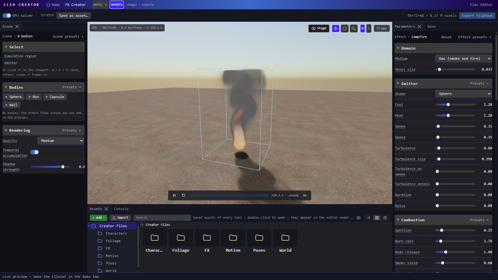

The **Viewport** runs the simulation continuously and draws it as a real engine volume, lit by the
scene's sun and hidden behind the ground like anything else in a game. Every parameter change reaches
the next simulation step, so there is nothing to press to see it; only the region size, **Voxel size**
and **Seed** start the simulation over. Drag to orbit, right-drag to pan (the mouse is captured while you
drag), scroll to move closer. The move / rotate / scale buttons top-right of the viewport are the editor's.

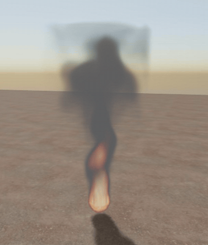

The **left** panel is what is in the scene: what is selected, the bodies and how the viewport renders. The light on the stage -- the sun (the one light the effect is shaded with, in the
viewport and in the bake), sky, exposure, wind and fire light -- is the viewport's **Stage** menu, as in the
Foliage Creator: see [Stage](#stage). The **right** panel is the effect itself. Both panels have
whole-panel presets at the top and a **Presets ▾** menu on each section, which only changes that section.

The **playback bar** along the bottom of the viewport runs the live simulation: play / pause (**Space**),
start over, and the speed. Its track is the play-through: a one-shot -- a gas burst (a **Duration** above
0), a splash -- fills it and replays from the start once it has played out; a steady effect (a flame, a
pour that never stops) runs on and shows a dimmed track.

The solver runs as GPU compute when the engine's device has it (the WebGPU backend), and otherwise as
the CPU solver in a background worker, so the editor stays responsive either way.

Baking lives in the **Bake** tab, beside **Parameters** on the right: see [Bake](#bake). **Export
flipbook** in the toolbar writes the baked files.

The solver is an Eulerian gas solver: semi-Lagrangian advection, a Jacobi pressure projection that keeps
the flow incompressible, vorticity confinement to restore the swirls the grid smooths out, and a
combustion model where fuel above the ignition temperature burns into heat and smoke (Stam 1999;
Fedkiw, Stam and Jensen 2001; Nguyen, Fedkiw and Jensen 2002). Every value is in SI units: sizes and
places in metres, speeds in m/s, forces in m/s², rates per second. The voxel size is only the detail: a
finer grid never changes how big the effect is or how fast it moves. Every preset is the size of the real
thing it is -- see [Real-world scale](#real-world-scale).

What the viewport's gizmos set -- where the emitter is, its size and aim, the region -- has no field in the
panels: see [Select](#select). Their rows below say what each one is.

## Domain

The simulation region: the box the effect lives in -- **room** around it, not its scale. The emitter, its
radius and the turbulence are in metres, so growing a face gives an explosion space to bloom past where it
stopped instead of a bigger explosion; the emitter keeps its place in the world while you drag. A liquid's
detail follows its droplets, so a bigger region never blurs its splash or its pools. For a liquid the region
frames only the drops in flight -- what the sprite shows: a drop that leaves it keeps flying and lands, and
the pool on the floor covers everywhere the liquid can reach, so its decal is never cut at the region's walls.
Size the region for the sprite; the pool comes out the same. Select **Simulation
region** in the viewport to move it (**W**) or drag the square handles on its faces to resize it (Alt
resizes about the centre, Ctrl snaps); see [Region](#region).

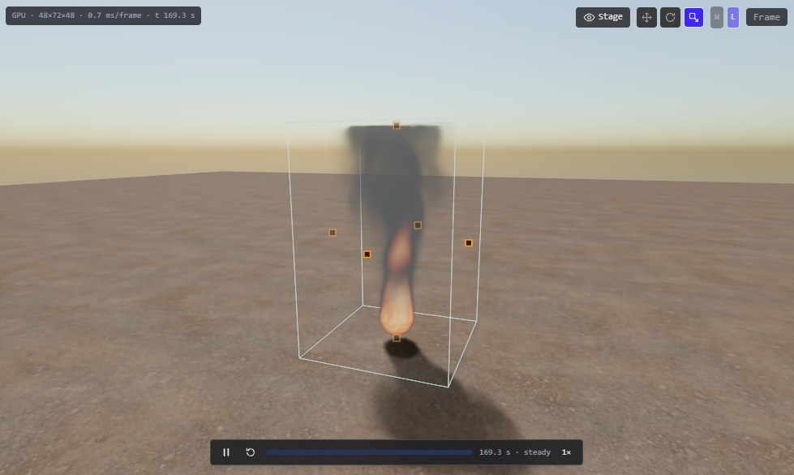

| Field | Meaning |
|---|---|
| **Medium** | Gas (smoke and fire, the voxel solver below) or Liquid (particles, see [Liquids](#liquids)). Each shows its own sections. Switching starts from that medium's first preset: Blood spatter for a liquid, the Campfire for a gas. |
| **Voxel size** | A gas's metres per voxel: the detail. Halving it gives eight times the voxels; speeds and forces are in metres, so the effect moves the same at any voxel size. Past 2.5 million voxels the size is raised to fit: the toolbar's count turns amber and shows the grid actually used, and voxel-sized detail grows with it -- shrink the region or raise the size yourself. The CPU solver is practical up to about 250 000 voxels. A liquid has none: its voxels follow its **Droplet size**. |

## Emitter

Where fuel, heat and smoke enter the domain.

| Field | Meaning |
|---|---|
| **Shape** | A sphere, or a flat disc one voxel thick. |
| **Radius** | The emitter's radius, in metres: the scale gizmo on the selected emitter sets it. |
| **Position** | Where the emitter is, in metres: across and through from the centre of the region's floor, and its height above the floor. The move gizmo on the selected emitter sets it. |
| **Fuel** | Fuel the emitter holds its volume at. |
| **Heat** | Temperature the emitter holds its volume at; above **Ignition** the fuel burns. |
| **Smoke** | Smoke added directly, before any burning, per second. |
| **Speed** | Upward velocity the emitter imposes, m/s. |
| **Turbulence** | Noise stirred into hot gas: an acceleration, m/s². It only stirs: the push it adds over the whole gas is taken back out every step, so a flame in still air sways but never drifts off to one side. |
| **Turbulence size** | The size of the turbulence's eddies, in metres. The noise is anchored on the emitter, so it stays the same under the flame however the region grows. |
| **Turbulence on smoke** | How much the turbulence also stirs smoke that has cooled, not only hot gas. Missing motion in the smoke is what most often makes a simulation look fake. |
| **Turbulence detail** | A second, finer turbulence octave (2.7 times the frequency), relative to the first. |
| **Duration** | How long the emitter runs; 0 keeps it on (a flame), a short burst makes an explosion. |
| **Noise** | Per-voxel, time-varying jitter of the fuel, heat and speed the emitter holds: flicker and a ragged source instead of a perfect ball. |

## Combustion

How fuel burns once it is hot enough.

| Field | Meaning |
|---|---|
| **Ignition** | Temperature above which fuel burns. |
| **Burn rate** | Fuel burned per second once ignited. Small fires burn faster: everything per second goes as one over the square root of the size (see [Real-world scale](#real-world-scale)). |
| **Heat release** | Temperature released per unit of fuel burned. |
| **Smoke yield** | Smoke left per unit of fuel burned. |
| **Expansion** | Burning gas expands: the pressure solve is given that much outward flow per unit of fuel burned, so a fireball blooms outward instead of only rising. |
| **Flame shape** | How much the fire is the thin sheet where fuel is burning right now (the flame field, as in Houdini Pyro and EmberGen) rather than all hot gas. 0 is the soft glowing blob; toward 1 flames become thin, licking sheets. |
| **Flame lifetime** | How long the flame field lasts after fuel at a point stops burning. Shorter gives sharper, shorter tips. |
| **Flicker** | Fuel pulses per second: a candle's or torch's rhythm. 0 is steady. |
| **Blast** | An outward push at the emitter for the first tenth of a second, per second: an explosion's shock, blooming the fireball outward. |
| **Max temperature** | Burning gas heats toward this temperature instead of without limit (Nguyen et al. 2002), so the core reaches white-hot and stays there. Radiative cooling is then measured over the range from the ambient temperature to it. 0 is off. |
| **Ambient temperature** | The surrounding air's temperature: buoyancy lifts gas by how much hotter than it the gas is. 0 is off. |

## Forces

What moves the gas besides its own momentum.

| Field | Meaning |
|---|---|
| **Buoyancy** | Hot gas rises: m/s² per unit of temperature. The same at every size, as gravity is. |
| **Smoke weight** | Smoke sinks: m/s² per unit of density. |
| **Vorticity** | Confinement strength, per second (Fedkiw's epsilon): higher keeps more curl and detail. |
| **Wind** | A steady push along +X, m/s. |
| **Disturbance** | Random velocity kicks in hot or smoky gas (m/s²), one per block, re-seeded every interval. Breaks smooth sheets into tongues and billows, the detail real fire and smoke have and a grid smooths away. Like the turbulence, it only stirs: its net push is taken back out. |
| **Disturbance size** | The size of those blocks, in metres. |
| **Disturbance interval** | Seconds between re-seeds: shorter is busier. |
| **Shredding** | Stretches the flow along hot edges, pulling flames and wisps into thin licks. Per second. It stretches the flow's own detail (the velocity less its neighbours' average) and its net push is taken back out each step, so it shapes the flames without growing a lean that would slide the whole effect sideways. |
| **Settling** | Dust falling through the air at its own speed, in metres per second. |
| **Ground drag** | Slows gas in the bottom voxels, per second, so ground-level dust and smoke spread and hug the floor. |

## Dissipation

How heat, smoke and motion fade.

| Field | Meaning |
|---|---|
| **Cooling** | How fast temperature falls, per second. Shorter flames cool faster. |
| **Smoke fade** | How fast smoke thins out, per second. |
| **Velocity damping** | How fast motion settles, per second. |
| **Radiative cooling** | Hot gas also cools as T⁴, so the hottest parts cool fastest: short, sharp, ragged flame tips. Per second. |
| **Diffusion** | Smoke and heat spreading into the air around them, m²/s, so smoke thins as it spreads rather than only fading. |
| **Condensation** | Steam: the emitter breathes out invisible vapour, which turns into visible droplets where it cools below the **Dew point** and evaporates again above it. Steam then appears a little above the vent and vanishes as it mixes. 0 is off. |
| **Dew point** | The temperature below which the vapour becomes visible. |

## Liquids

A liquid is particles, not a grid: drops that push apart where they crowd and pull together at a free
surface (Clavet, Beaudoin and Poulin 2005, double density relaxation), so a thrown sheet tears into
threads and the threads bead into drops by themselves. What lands on a solid floor becomes a **film**, a
height field that flows out, stops at a ragged edge and soaks in; that film is the [floor decal](#outputs).
The region is not a wall for either: the drops live wherever their release can reach -- worked out from the
release itself, how far each drop is thrown, bounces and could spread -- and only those inside the region
are drawn, in the viewport and in the sprite. A splash thrown above the region falls back into it.
The live preview draws the liquid as the engine's volume, surface-shaded, and the film as a decal on the
ground. A one-shot (a burst, or a jet with a duration) plays out, holds for a moment and replays.
Everything in the liquid sections is in metres and seconds, and the same parameters always bake the same
result.

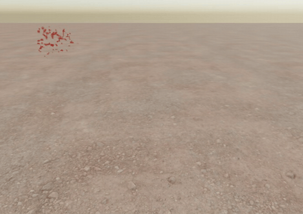

With **GPU solver** on (the WebGPU backend), the preview runs effects of 600 drops or more on the GPU,
many times faster: the water splash's 4,700 drops take about 20 ms a frame there against 400 ms on the
CPU. The floor film runs there too: a pool is stamped the frame its drops land, flows and soaks on the GPU, and
is drawn straight into the decal's textures. It runs the bake's flow (the same backward-Euler step, edge holds and
sweep count; its sweeps visit the cells line by line so the GPU can run them in parallel), so a spatter's drops leave
the same separate little pools in the viewport as in the baked decal. Smaller effects stay on the CPU, which is cheaper for a few hundred drops; the readout says which
ran. The GPU adds up each drop's pushes from its neighbours all at once rather than pair by pair, so its
drops are not the bake's drop for drop. Bakes always run the CPU solver, so every machine bakes the same
tileset.

## Splash source

Where the liquid comes from and how it leaves. The emitter marker in the viewport is the source: its
gizmos set where it is, its radius and its aim (see [Select](#select)).

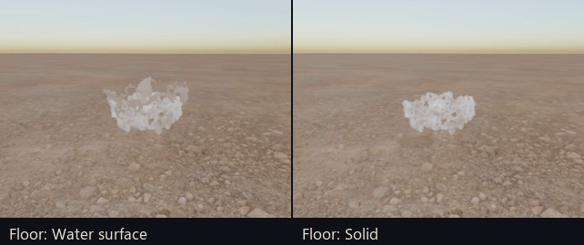

| Field | Meaning |
|---|---|
| **Source shape** | Point: a small ball of liquid thrown along the aim. Ball: a ball flying apart out of its centre (an impact burst). Disc: a nozzle across the aim. Ring: a ring on the floor thrown up and out, the crown a drop makes entering water. |
| **Source radius** | The ball's, disc's or ring's radius, in metres: the scale gizmo sets it. |
| **Source position** | Where the source is, in metres: across and through from the centre of the region's floor, and its height above the floor. The move gizmo sets it. |
| **Volume** | Litres released in all. With **Droplet size**, this is how many particles there are (and the cost). |
| **Release** | Burst: all at once at the start. Jet: poured over the jet duration. |
| **Jet duration** | Seconds a jet pours for. 0 pours for ever, at the volume per second: a looping stream. |
| **Source speed** | The slowest and fastest a drop leaves at, m/s. |
| **Aim yaw** | The aim's turn around the vertical, from +Z toward +X: the rotate gizmo's turn. A spatter decal's spray runs along +Z at yaw 0. |
| **Aim pitch** | The aim's angle up from the horizontal (-90 pours straight down): the rotate gizmo's tilt. For a ring, how steep the crown is thrown. |
| **Spray angle** | Degrees off the aim a drop may leave at; 180 sprays every way. For a ball, how radial the burst is. |
| **Break-up** | Noise on the release velocity, finer than the drops' shared motion: tears sheets into fingers. Speed and direction are mostly shared between neighbours, so liquid leaves in sheets and streams, not as a cloud of single drops. |
| **Crown core** | Ring only: the share of the liquid thrown straight up from the ring's centre, the jet that follows a crown. |

## Liquid

What the liquid is.

| Field | Meaning |
|---|---|
| **Droplet size** | The spacing of the particles at rest, metres: the smallest drop there can be, and the liquid's definition. The surface is drawn at voxels of about this size (in the viewport by **Quality**, in the bake at three quarters of it) over where the drops are, and the floor film's cells are half of it -- whatever the region's size. Halving it gives eight times the particles. Past 60 000 particles the size stays as authored and each drop carries more liquid, so a big pour lands as bigger splashes (the airborne drops are fewer than the liquid they stand for). |
| **Viscosity** | Thick liquids hold together and smear; 0 is water. On a log scale of the real viscosity: log10(μ / water's) / 3, so blood 0.18, mercury 0.06, motor oil 0.77, honey 1. |
| **Surface tension** | How hard a free surface pulls together. Low sprays into mist; high holds a blob together; between, sheets break into threads and drops. 0.55 is water's (72 mN/m), in proportion: blood 0.44, oil 0.23, mercury 1. A drop of only a few particles needs more to hold together than the real value. |
| **Stickiness** | The share of drops that stay where they first land on a solid floor instead of bouncing. |
| **Gravity** | Downward, m/s². 0 for a drop seen on its own. |
| **Air drag** | Per second: the air slowing the drops. The stage's wind, when on, is what the air moves at. |
| **Relaxation passes** | Density relaxation passes per step. More is less compressible and costs more. |

## Floor

What the region's floor does with the liquid that reaches it.

| Field | Meaning |
|---|---|
| **Floor** | Solid: drops bounce, or land and join the film, which flows and soaks in (and bakes the decal). Water surface: liquid falling back sinks in, for splashes on water. None: it falls through. |
| **Bounce** | How much of a drop's speed into the floor it keeps when it bounces. A drop stops bouncing after two bounces, or when it lands slowly. |
| **Friction** | How much of a drop's speed along the floor a bounce takes away. |
| **Flow** | How readily the liquid on the floor runs out: a thick puddle runs, a thin film barely creeps (the thin-film equation, mobility growing with the thickness cubed, stepped implicitly so it is stable at any cell size). The film's cells are half a droplet, and it is kept only where liquid has landed, so its cost is the stain's, not the region's. |
| **Edge hold** | Millimetres: liquid only advances onto dry floor from where it is thicker than this, so a pool stops instead of spreading for ever. Thicker holds make smaller, deeper pools. |
| **Edge noise** | How much the edge hold varies across the floor: ragged, natural pool edges instead of a disc. |
| **Soak** | Per second: the share of the wet film the floor soaks up into a matte stain. Stone barely; soil a lot. |

## Liquid look

How the liquid is shaded, in the viewport and in the baked tiles.

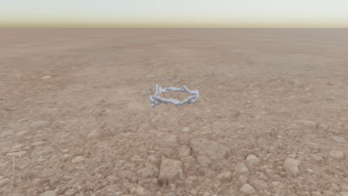

| Field | Meaning |
|---|---|
| **Liquid colour** | What the liquid scatters: its body colour where it is thick. |
| **Tint** | The colour light keeps after one absorption length of liquid. Blood keeps red, water a little blue. |
| **Absorption** | Per metre: how quickly the liquid takes the light through it. Blood about 900 (a millimetre is nearly opaque, so a pool hides the floor), water a few. |
| **Roughness** | The surface's roughness: 0 is a mirror. Also the wet film's on the decal. |
| **Metallic** | 0 for a liquid, 1 for a liquid metal (mercury, molten gold). A metal is opaque and has no body colour: **Liquid colour** becomes the colour of its reflections, of the sun's highlight and of the sky it mirrors, and its decal is metallic too. In between is a blend of the two. |
| **Specular** | Strength of the sun's highlight and the sky's reflection. |
| **Foam** | Fast-moving liquid turns white: the aerated spray of a water splash. |
| **Smoothing** | The surface's smoothing radius, in droplet sizes: blobby above 2, beaded below 1.5. |

## Simulation

Time stepping and the pressure solve.

| Field | Meaning |
|---|---|
| **Frame time** | Simulated seconds per flipbook frame; the flipbook plays at 1 / this. |
| **Substeps** | Solver steps per frame. More is more stable at high speeds. A liquid takes more on its own when it has to: no drop may cross more than a fraction of its neighbourhood in one step. |
| **Pressure iterations** | Iterations of the pressure solve per step. More keeps the flow closer to incompressible. |
| **Pressure solver** | Jacobi, or red-black SOR: Gauss-Seidel with over-relaxation, warm-started from the previous step's pressure. SOR reaches the same incompressibility in far fewer iterations. The live preview always uses it. |
| **Boundaries** | Closed walls on every side but the top, or open air: gas leaves through the sides instead of piling against invisible glass. The air that comes in through an open side is still, as the air around a real fire is, so no wind builds up through the box. |
| **Advection** | How the flow carries the smoke, heat and fuel. Semi-Lagrangian is plain and slightly blurry; MacCormack measures that blur with a backward pass and corrects it, keeping much sharper detail at the cost of two extra passes. |
| **Seed** | The turbulence's seed. |

## Look

How the volume is shaded, in the viewport and in the baked tiles.

| Field | Meaning |
|---|---|
| **Smoke colour** | Albedo of the smoke. |
| **Density** | Extinction per unit of smoke: how opaque it is. |
| **Fire colour from** | The gradient below, or black-body radiation: the hue of Planck's spectrum at each temperature, seen by an eye adapted to a white a quarter hotter than the hottest flame (the way Nguyen et al. render fire, but the eye adapts to the scene around a fire too, so it never takes the flame itself for white), with brightness rising as T⁴, so the hottest core reads pale yellow and white once bright, the body orange and the cool edges a deep, dim red. |
| **Fire colour** | Colour by temperature, from ignition (left) to the hottest (right). |
| **Coolest flame** / **Hottest flame** | Black-body temperatures, in kelvin, at ignition and at the top of the emission range. Wood fires run roughly 900 to 1500 K, gas burners hotter. |
| **Emission** | Brightness of the fire. |
| **Emission range** | Temperature span the fire colour covers above ignition. |
| **Ambient** | Light reaching smoke in its own shadow. |
| **Anisotropy** | How directionally the smoke scatters light (Henyey-Greenstein). Above 0 it scatters forward, so smoke between you and the sun gets a bright rim; 0 scatters evenly. |
| **Scattering octaves** | Approximates light bouncing several times inside the smoke (Wrenninge's octaves), so thick smoke is not flat grey in its core. 1 is single scattering. |
| **Fire glow** | How strongly the fire lights the smoke around it, so smoke above a flame glows orange. |
| **Detail** | Procedural noise that erodes the smoke below the size of a voxel, drifting upward with time. |
| **Detail scale** | How fine that noise is: features per ten voxels. |
| **Fire intensity** | Fire brightness relative to the smoke. Above 1 the fire outshines lit smoke and drives bloom in the viewport; a bake rolls it off smoothly into the tiles. |
| **Albedo** | The share of the light the smoke stops that it scatters rather than absorbs: near 1 bright steam, low values dark soot. |
| **Powder** | Dark edges on dense smoke facing the light (the Beer-Powder effect of real clouds and billows). |
| **Sky occlusion** | How much the smoke above shades the sky light below it, darkening the undersides of plumes. |
| **Flame opacity** | How much the fire hides what is behind it. Real flames are nearly transparent (about 0.05): they give light, and only soot and smoke absorb it. It never changes how bright the fire is. |
| **Blue core** | A faint blue where fresh fuel first burns, before soot forms: the foot of a flame. The zone is the first 30 % of a clean fuel's burn and thinner the sootier the fuel (**Smoke yield**); at 1 its blue is about a tenth of the fire's brightness, so it shows at the dim edges of the foot and never tints a white-hot core, and dense smoke hides it. A candle shows a hint of blue at its foot, a sooty torch or a wood fire next to none. 0 is off. |
| **Blue core colour** | Its colour. |
| **Soot mask** | Fire inside dense smoke is dimmed by it, so the glow shows through the gaps in the soot. |
| **Glow threshold** | Only fire hotter than this share of the emission range lights the smoke around it (**Fire glow**), so the glow comes from the core rather than every warm wisp. |
| **Absorption colour** | The colour thin smoke tints the light passing through it. White is grey smoke; a warm colour (Houdini Pyro suggests about 0.43, 0.36, 0.30) absorbs blue fastest, so thin smoke reads brown and thick smoke dark. The smoke still scatters grey. |
| **Smooth sampling** | Samples the voxels with a tricubic B-spline (Sigg and Hadwiger) instead of trilinearly, so the gas has no blocky voxel edges. Costs eight times the texture reads. |
| **Sharpen** | Density contrast: thin smoke thinner, dense cores denser, for crisper edges. Pairs well with smooth sampling. |

The detail noise rides the flow: it is sampled where each bit of gas came from (two sets of advected noise
coordinates, cross-faded so their resets are never seen), so it stretches and swirls with the smoke.

## Select

What the viewport's gizmos act on. Click a body, the emitter or the region in the viewport, or pick it here.
**W**, **E** and **R** switch between move, rotate and scale; **X** flips the gizmo between world and local
axes; **F** frames the selection; **Delete** removes a selected body; **Escape** clears the selection.

These values are set here and nowhere else -- the panels have no fields for them; the drag readout shows
the exact value while you drag:

- **The emitter:** move sets its **Position** (a liquid's **Source position**), in metres from the centre
  of the region's floor; scale sets its **Radius** (**Source radius**). A liquid's emitter also rotates:
  that is its **Aim yaw** and **Aim pitch**, and the arrow drawn from it shows where it throws (a crown's
  four arrows show the pitch its ring throws at, all round). A gas has no aim, so rotate moves it. A
  liquid starts over once a drag ends, not on every mouse move.
- **The region:** move (**W**) moves it, emitter and all; its face handles resize it, the emitter staying
  where it is in the world. Its box stays drawn, brighter while it is selected.
- **A body:** move, rotate and scale set its **Position**, **Turn** / **Tilt** and **Size**.

## Region

The simulation region: the box the effect lives in, and where it stands. Both are set with its gizmos.

| Field | Meaning |
|---|---|
| **Region size** | Width, height and depth of the box, in metres: its face handles set it. Part of the effect: the bake frames it, so a bigger box leaves more room around the effect in each tile. A gas gets more voxels at the same **Voxel size**, so it costs more; a liquid costs only where its drops are. A liquid's pool and its floor decal do not depend on it: the drops fly on past its walls and land. |
| **Region position** | The centre of the region's floor, in metres: the move gizmo sets it, and a face handle moves it so the opposite face stays put. Preview only, as a bake frames the region itself. |

## Stage

The **Stage** menu, top-right of the viewport beside the move / rotate / scale buttons: the stage the effect
is previewed on, laid out as the Foliage Creator's. None of it reaches the bake except the sun's direction.

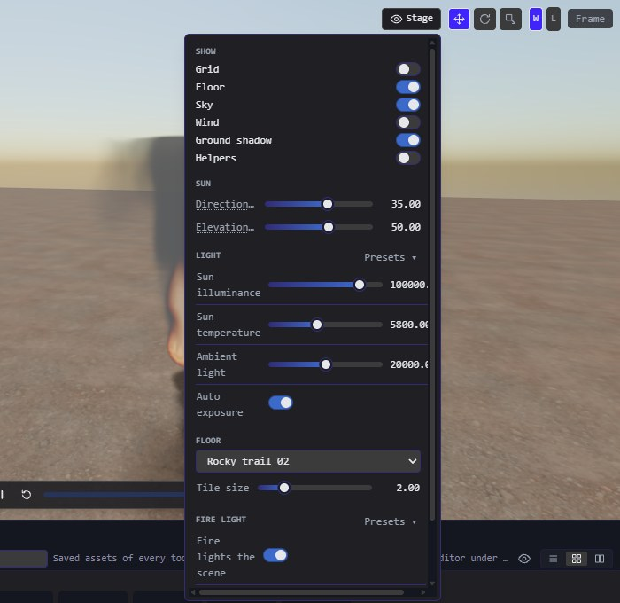

**Show** — what the viewport draws:

| Row | Meaning |
|---|---|
| **Grid** | The editor grid on the ground. |
| **Floor** | A matte ground plane, for the fire light and shadows to land on. |
| **Sky** | A physical atmosphere behind the effect, which also lights the smoke from the sky. Off is a flat backdrop. |
| **Wind** | A wind across the stage (see [Wind](#wind)). |
| **Ground shadow** | A gas: its shadow on the floor, the light reaching the ground through the smoke toward the sun, drawn as a decal. Its darkness is **Shadow strength** under Rendering. A liquid's mark on the floor is its film. |
| **Helpers** | What the stage draws that the effect does not: the simulation region's box, the emitter marker and its aim (both shown while selected either way) and the placed bodies. Hidden bodies still shape the flow. |

**Sun** — **Direction** is the sun's compass direction, **Elevation** its height above the horizon. The sun
is the one light the effect is shaded with, so its direction lights the viewport and the baked tiles alike.

### Light

The sun's strength and colour, the ambient and the camera's exposure. Its presets are times of day.

| Field | Meaning |
|---|---|
| **Sun illuminance** | Direct sunlight, in lux. A clear noon is about 100 000 lux. |
| **Sun temperature** | The sun's colour as a colour temperature: about 2000 K at sunset, 5800 K at noon. |
| **Ambient light** | Flat light from every direction, in lux. |
| **Auto exposure** | Let the camera adapt to the scene's brightness, as a game camera does. Off, **Exposure** sets it by hand. |
| **Exposure** | Manual exposure, EV100. |

### Wind

While **Wind** is on: an engine Wind node, and a force on the gas (or the drops) that pulls it toward the wind's speed.

| Field | Meaning |
|---|---|
| **Direction** | Where it blows toward, degrees counter-clockwise from +X seen from above. |
| **Strength** | Wind speed, metres per second. |
| **Gustiness** | How much of the wind comes and goes with the gusts. 0 is steady. |
| **Gust size** | Metres between gust crests. |
| **Gust speed** | How fast the gusts travel. |

### Floor

The ground's material: one of the PBR sets the build carries, or **Plain**. Decals (the effect's shadow, a liquid's pools) draw on it as on any floor.

| Field | Meaning |
|---|---|
| **Floor** | The set the ground wears. |
| **Tile size** | Metres one repeat of the set's maps covers. The floor is a non-repeating re-make of the set (random offsets and quarter-turns, blended at their borders), so tiling does not show; the set's height map is drawn as parallax relief. |

### Fire light

A gas: a point light that follows the flame, placed at its glowing centre and as bright as the flame is big, so the fire lights the ground and the bodies around it.

| Field | Meaning |
|---|---|
| **Fire lights the scene** | Add the light. |
| **Brightness** | Lumens with the whole flame burning. |
| **Flicker** | Random brightness changes, smoothed so they read as fire rather than noise. |

## Rendering

How the viewport draws the volume.

| Field | Meaning |
|---|---|
| **Quality** | Low runs fewer pressure iterations, marches the volume in longer steps at half the screen resolution and updates the self-shadowing less often, for big grids or slower machines. High uses finer steps at full resolution. A bake always uses the effect's own values. |
| **Shadow strength** | How dark that shadow can get. |
| **Temporal accumulation** | Each frame casts one jittered ray per pixel with longer steps, and blends it with the previous frames reprojected through where the smoke is: the volumetric clouds' and TAA's technique. Much cheaper per frame for the same settled quality; fast changes take a few frames to settle. While the camera moves or a setting changes, the march takes longer steps still and leans on the new frames. |

## Bodies

Static objects the effect flows around, never through, in the preview: real engine models with physics
bodies. Smoke spreads under a lid, eddies behind a wall, and a body casts a shadow into the smoke; a splash
glances off a ball, runs down a wall and pools against its foot, its film stopping where the body stands.
A new body goes where it shows at once: beside or above a gas, in a liquid's path (a ball or a post along
its aim, a wall across it, a block where it comes down). Adding or moving one replays a liquid's one-shot,
so it splashes against it. Bakes leave bodies out. In the panel each one has its **In the scene** switch
and a remove button; its gizmos set the rest:

| Field | Meaning |
|---|---|
| **In the scene** | Off, the body is hidden and the gas ignores it. |
| **Position** | Its centre, in metres: the move gizmo sets it. The effect stands on the origin. |
| **Size** | Full extents: the scale gizmo sets them. A sphere's diameter is X; a capsule's diameter is X and its overall height Y. |
| **Turn** | Rotation around the vertical axis: the rotate gizmo's turn. |
| **Tilt** | Rotation around the body's own X axis, after the turn: the rotate gizmo's tilt. |

## Presets

**Effect presets** replace every parameter with a starting point (the seed, the sun's direction and the
Bake tab's settings included), keeping only the viewport's preview quality. The header shows the preset
picked last, and **Reset** returns every parameter to it (to the defaults before any is picked). The presets: a
campfire (plain and realistic), torch, smoke plume, explosion burst, candle, bonfire, gas burner, brazier,
chimney smoke, steam vent, smouldering embers, magic fire, fireball, large explosion, muzzle flash and a
dust puff; and the liquids: a blood burst (the sprite of a hit), looping blood droplets (for
velocity-aligned particles), a blood spatter and a blood pool (both with their floor decals), a water
splash (a crown and its jet, sinking into a water surface), looping water droplets, a water puddle (rain
water poured onto the ground and settling into an uneven puddle about a metre across, for its floor decal),
and a mercury splash
(a foot coming down in mercury: beads thrown low that roll and stay beaded, with surface maps and its
decal). Each is the size of the real thing, in a region with room around it and a voxel size for its
detail: see [Real-world scale](#real-world-scale). Section presets on the **Emitter**, **Combustion**,
**Forces** and **Dissipation** sections are written for the campfire and scaled to the effect they are
applied to, so a "Lively" candle moves like a lively candle.

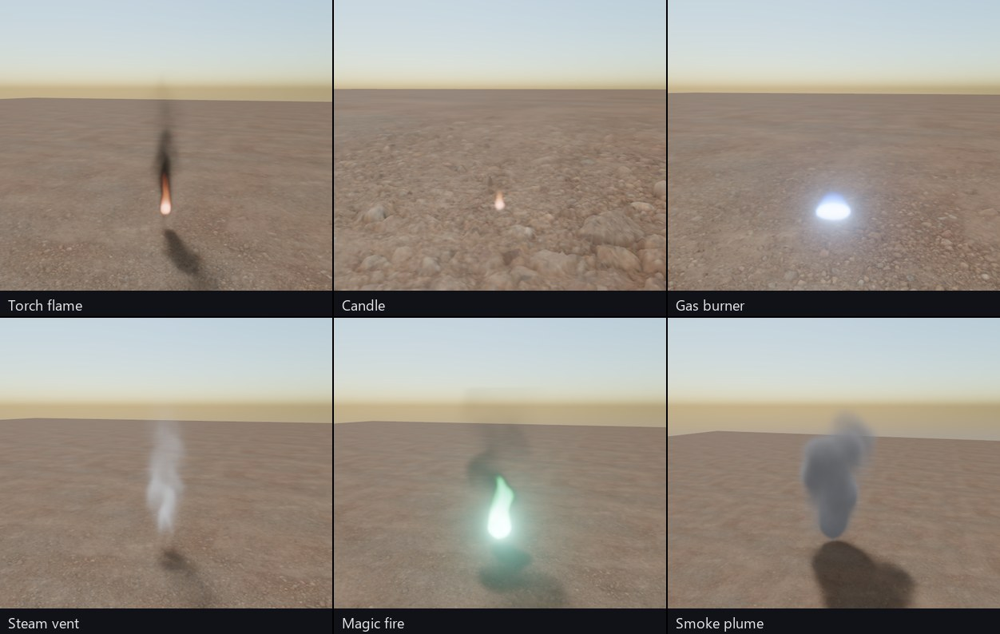

## Real-world scale

The presets are the real things, measured: a gas effect's flame height (or its source, or its fireball)
was measured on the solver and the preset scaled to the real size by Froude similarity -- the scaling of
flows driven by gravity, which keeps an effect looking the same at any size: lengths by s, speeds by √s,
time and the frame time by √s, rates by 1/√s, forces unchanged. The grid keeps its voxel count, so the
cost stays the same, and small flames move and flicker faster, as real ones do (a fire's puffing frequency
goes as 1.5 / √D Hz for a base D metres across). Liquids were already life-size.

| Preset | The real thing |
|---|---|
| Candle | a 4 cm flame |
| Gas burner | a 10 cm blue flame on a burner port |
| Torch | a 45 cm flame on a 10 cm head (about 10 kW) |
| Campfire, realistic campfire, magic fire | 0.9 m flames over a 0.6 m bed (about 100 kW) |
| Brazier | 0.7 m flames over a 0.6 m bowl |
| Bonfire | 2.4 m flames, about 2 m across (about 1.5 MW): a ball of fuel, so the flames stand up instead of running out along the floor |
| Smouldering embers | a 0.8 m bed |
| Smoke plume, chimney smoke, steam vent | a 0.6 m smouldering source, a 0.3 m flue, a 15 cm vent |
| Dust puff | 1.5 m across |
| Fireball, explosion burst, large explosion | fireballs 2 m, 4 m and 12 m across (about 0.3 kg and 9 kg of fuel) |
| Muzzle flash | 30 cm long |

Flame heights follow Heskestad's correlation, L = 0.235 Q^⅖ − 1.02 D (Q the heat release in kW, D the base
in metres); fireball diameters the CCPS correlation, D = 5.8 M^⅓ (M the fuel in kg).

The other values follow one table each, so the same material is the same value everywhere:

| Fire | Black-body range |
|---|---|
| Wood (campfire, torch, brazier, bonfire) | 950 to 1600 K |
| Candle | 1300 to 1800 K |
| Embers | 800 to 1200 K |
| Explosions and fireballs | 1100 to 2000 K |
| Gas flame | not a black body: blue from CH and C2 emission (the gas burner's gradient); the flame is 1900 to 2200 K |

| Smoke | Albedo |
|---|---|
| White smouldering smoke, smoke plume, embers | 0.85 |
| Flaming wood | 0.5 to 0.55 |
| Sooty (torch, brazier, chimney, explosions) | 0.3 to 0.35 |
| Steam | 0.97 |
| Dust | 0.8 |

| Liquid | Viscosity (mPa·s) | Surface tension (mN/m) | Density (kg/m³) | Sliders |
|---|---|---|---|---|
| Water | 1.0 | 72 | 1000 | viscosity 0, surface tension 0.55 |
| Blood | 3.5 to 4 | 58 | 1060 | 0.18, 0.44 |
| Mercury | 1.5 | 485 | 13 534 | 0.06, 1 |
| Motor oil | about 200 | 30 | 870 | 0.77, 0.23 |

A pool's **Edge hold** is about its capillary length: blood about 2 mm, mercury about 4 mm.

## Bake

The **Bake** tab turns the effect into textures. **Bake flipbook** runs its own simulation from the
start (warm-up, capture, loop blend), so the live preview keeps going beside it; **Export flipbook**
in the toolbar writes the files. The **Output** menu picks which baked atlas the player and the atlas view show. **Bake presets**
set up the whole tab: Game-ready (8 × 8 frames of 128 px), Hero (8 × 8 of 256 px, relightable), Mobile
(4 × 4 of 64 px), Explosion one-shot and Liquid splash (24 frames from the release, and the floor decal).

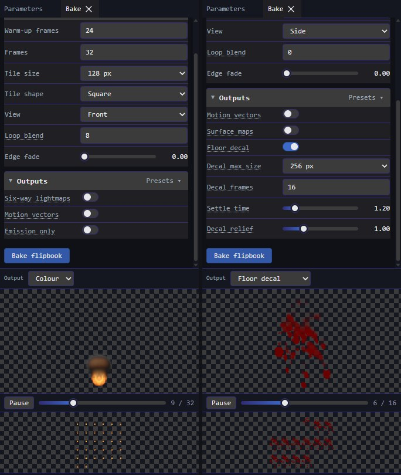

### Flipbook

| Field | Meaning |
|---|---|
| **Warm-up frames** | Frames simulated before the first captured one, so the fire is established. |
| **Frames** | Frames in the flipbook. The atlas is the squarest grid that holds them. |
| **Tile size** | Pixels per frame (along the short side of a tall or wide tile). |
| **Tile shape** | Square, tall (twice as tall as wide: a flame) or wide. The atlas packs them into the squarest image: 32 tall frames are 8 × 4. |
| **View** | The camera: front, side, top, or an angle around the vertical axis (**Yaw**). Orthographic, framing the whole domain. |
| **Loop blend** | Frames rendered past the end and cross-faded into the start, so the flipbook loops without a pop. 0 plays once (an explosion). |
| **Edge fade** | The share of the frame at each edge over which coverage fades out, so a flame that reaches its region's edge never ends on a straight line on the sprite. 0 is off. |

### Outputs

| Field | Meaning |
|---|---|
| **Six-way lightmaps** | The smoke lit from six directions, so a game can relight the flipbook with its own lights (Unity VFX Graph and Unreal six-way lighting). Two atlases: `_6way_pos` holds the light from the right, top and back in RGB with the alpha in A; `_6way_neg` the left, bottom and front in RGB with the fire's emission in A. Directions are the tile's own: back is away from the camera. |
| **Motion vectors** | The flow on screen, for flipbook frame blending that morphs instead of cross-fading. R and G are 0.5 plus the motion to the right and up, in tile widths per frame, times **Motion scale**; a blend shader divides it back out. |
| **Motion scale** | That encoding's scale, written to the sidecar. |
| **Emission only** | The fire's light alone, behind the smoke in front of it, for an additive particle layer. |
| **Surface maps** | A liquid's surface for a lit particle, so the engine lights the sprite with the scene's own lights rather than the bake's. Three atlases cut like the colour atlas: the unlit base colour, with the body's opacity in alpha (`_albedo_flipbook`); a tangent-space normal map, OpenGL convention -- R right, G up, B toward the viewer (`_normal_flipbook`); and an ORM map -- occlusion, roughness and metallic (`_orm_flipbook`). Synced into the editor, the effect's emitter draws them, lit. Suited to liquids you cannot see through (blood, mercury, oil, paint); a clear one like water still reads best from the colour atlas, whose reflections are baked in. |
| **Floor decal** | A liquid on a solid floor: the film it leaves, seen from above, as a decal flipbook -- base colour with coverage in alpha (`_decal_flipbook`), a normal map of its relief (`_decal_normal_flipbook`) and an ORM map, wet glossy and soaked matte (`_decal_orm_flipbook`); and the settled last frame of each alone (`_decal`, `_decal_normal`, `_decal_orm`). |
| **Decal max size** | Most pixels a side of a decal frame. A frame covers only where the liquid lies, drawn at the film's own cells (half a droplet), so the stain is as sharp in a 4 m region as in a 1 m one; past this size it is drawn at coarser cells. |
| **Decal frames** | Frames of the decal flipbook, captured evenly from the release to the settle time. |
| **Settle time** | Seconds the floor keeps flowing after the last sprite frame, so the decal ends on a pool that has stopped. |
| **Decal relief** | Strength of the normal map. |

The colour atlas is straight-alpha RGBA, frames left to right then top to bottom. Fire carries at least
its own brightness as alpha, so transparent flames still show in it. The `.tileset` describes its grid;
`fx.json` carries a `particleFlipbook` block (columns, rows, frames, FPS) for a particle system's
**Render** module, and an `outputs` block naming the extra atlases and their conventions.

A floor decal's block (`outputs.decal`) is what a [Decal](../editor/node-inspector.md#decal) plays it by:
the `size` of floor it covers (the decal box's X and Z: where the liquid lies, not the region), its
`offset` (that box's centre, X and Z metres from the centre of the effect's floor -- stand the decal there),
`tile` (a frame's pixels, width and height), its `flipbook` (columns, rows, frames, FPS, played once from
the effect's start and held on the settled frame) and its `albedoOpacity`. A clear liquid only
darkens the ground, so its colour is near black and its albedo share small, while its roughness lands
whole: wet ground. In the editor a synced liquid brings two decal materials, the settled frame and the
animated atlases (give the decal the block's flipbook).

### In the engine

The game never runs the simulation: it plays the bake. A fire becomes a flipbook on a camera-facing
sprite (an **Animated Sprite**, or a particle system's **Render** module, at the sidecar's columns, rows and
FPS); a liquid's floor becomes a [Decal](../editor/node-inspector.md#decal) playing its decal flipbook
once and holding the settled pool. The Valley example's flames, blood and splashes are made this way:
`tools/valley/creatorFx.mjs` names each one's Creator preset, seed and few overrides, and the Valley build
bakes them headless with the same solver, renderer and exporter as **Export flipbook**.

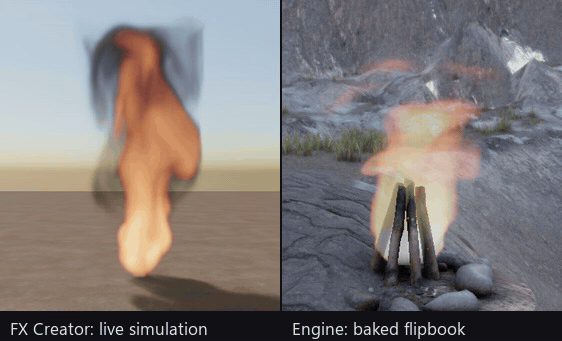

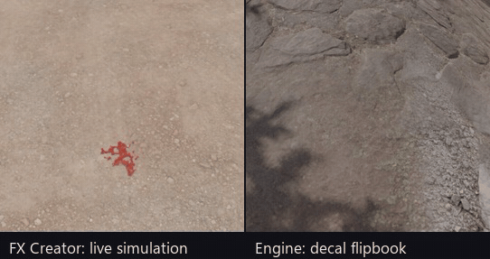

A flipbook is the effect from one view, so it reads best from about that view: a flame's tall tile
turns to face the camera about its vertical axis, and a decal lies flat on whatever is under it. Size
the sprite to the effect's region as the tile frames it, and the decal box to the decal block's `size`,
and the effect keeps its real proportions in the game.

## References

- Nguyen, Fedkiw and Jensen 2002, *Physically Based Modeling and Animation of Fire*: the temperature model, black-body colour with adaptation, the blue core.
- Houdini Pyro shading documentation: absorption colour, fire masked by smoke, scatter from a temperature range.
- Scratchapixel, *Volume Rendering for Developers: Voxel Grids*: trilinear sampling and its higher-order alternatives.
- Sigg and Hadwiger 2005, *Fast Third-Order Texture Filtering* (GPU Gems 2): tricubic B-spline from trilinear taps.
- Wyman, Sloan and Shirley 2013, *Simple Analytic Approximations to the CIE XYZ Color Matching Functions*; CIECAM02's CAT02 adaptation.
- FumeFX realistic fire and smoke (Super Renders Farm): motion complexity over settings; turbulence on smoke.
- Six-way lightmaps: Unity VFX Graph and Unreal documentation; *Real-time Neural Six-way Lightmaps* (2026).
- Clavet, Beaudoin and Poulin 2005, *Particle-based Viscoelastic Fluid Simulation*: double density relaxation and pairwise viscosity, the liquid solver.
- Oron, Davis and Bankoff 1997, *Long-scale evolution of thin liquid films*: the lubrication equation the floor film flows by.
- Teschner et al. 2003, *Optimized Spatial Hashing for Collision Detection of Deformable Objects*: the neighbour grid's hash.
- Heskestad 1983, *Luminous heights of turbulent diffusion flames* (Fire Safety Journal), and the SFPE Handbook's chapter on fire plumes and flame height: the presets' flame heights.
- Cetegen and Ahmed 1993, *Experiments on the periodic instability of buoyant plumes and pool fires* (Combustion and Flame): puffing at about 1.5 / √D Hz.
- CCPS, *Guidelines for Evaluating the Characteristics of Vapor Cloud Explosions, Flash Fires, and BLEVEs*: fireball diameter 5.8 M^⅓.
- Sunderland et al. 2011, *Analysis and measurement of candle flame shapes* (Proceedings of the Combustion Institute): candle flame sizes.
- CRC Handbook of Chemistry and Physics: viscosity, surface tension and density of water and mercury; whole blood's from the haemorheology literature (about 3.5 to 4 mPa·s at high shear, about 58 mN/m).

## Licensing note

The solver is written from the published papers above. A US patent (7,472,046) describes a solver built
from the same pieces; it has not been reviewed, and a freedom-to-operate check is needed before this
solver ships in a product (see the research plan, B6).
