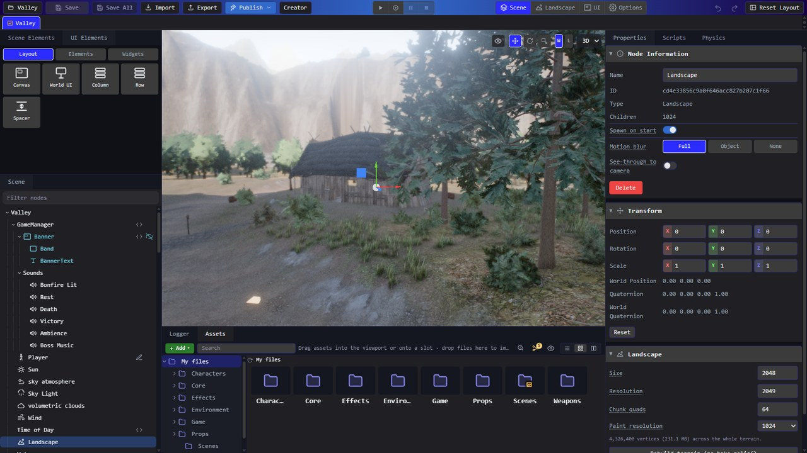

# The editor interface

The shell: a menu bar, a strip of document tabs, and a dockable workspace of panels.



```
┌──────────────────────────────────────────────────────────────────────┐
│ (logo) File Edit View Project Help   ▶ ▾ ◎ ❚❚ ■   [ Scene | Landscape │
│                                                   | UI | Options ] Claude │
├──────────────────────────────────────────────────────────────────────┤
│ Main Scene ● │ Rock.model │ Stone.mat │ Player.script │ ✕            │
├───────────────┬──────────────────────────────────┬───────────────────┤
│ Scene         │                                  │ Properties        │
│ Elements      │            Viewport              │ Behaviors         │
│ UI Elements   │                                  │                   │
│───────────────│                                  │                   │
│ Scene tree    │                                  │                   │
├───────────────┴──────────────────────────────────┴───────────────────┤
│ Logger │ Assets                                                      │
└──────────────────────────────────────────────────────────────────────┘
```

## Menu bar

**Left** — the Cleo logo, then the menus.

The **Cleo logo** opens the project browser ([Projects](projects.md)); pointing at it runs the splash
screen's pixel scan across it, and its tooltip names the open project.

| Menu | Holds |
|---|---|
| **File** | **Save** (Ctrl+S) the active tab, **Save All** (Ctrl+Shift+S) every tab with unsaved changes, **New Scene**. |
| **Edit** | **Undo** and **Redo** (named after what they undo), **Delete** the selected node. |
| **View** | **Frame Selected** (F) and **Reset Layout**. |
| **Project** | **Import Project…** (a project `.zip`), **Export Project** (the whole project to a `.zip`), **Features…** (the engine features the games ship, see [Project features](project-features.md)), **Addons…** (editor addons: the MCP server and Claude Code, see [Addons](addons.md)), and **Publish ▸** Web (HTML), Desktop (Electron) or Desktop installer. See [Projects](projects.md) and [Publishing](publishing.md). |
| **Help** | **Documentation** (F1), **What's This?** (Shift+F1), **Keyboard Shortcuts…** (the table below), **Check for Updates…** (desktop, see [Updates](#updates)) and **About Cleo Engine…** (the version and what changed in it). See [Help and the docs](#help-and-the-docs). |

Click a menu to open it; while one is open, pointing at another opens that one instead. The arrow keys move
through the menus and their items, Enter chooses, Esc closes.

**Frame Selected** brings the selected node to the middle of the view being edited (in a
[split viewport](scene-authoring.md#split-viewport), the pane being edited). The camera keeps the way it
looks and moves along it until the node fills the view; an orthographic view slides across and zooms
instead. It moves the editor camera only, so it does nothing during Play.

After the menus come, when there is something to say:

| Item | Shows |
|---|---|
| **Status** | What Save, Save All or Publish did last: *Saving…*, *Saved*, *Save failed*, *Publishing web build…*. |
| **Folder chip** | Desktop. Appears only when the [project folder](project-folders.md#changes-outside-cleo) needs attention: files changed on disk (**Reload from disk**), files Cleo cannot read, a write the folder refused, deletions waiting for a yes, or a folder gone missing. |
| **Agent chip** | The agent link: shown while the MCP server addon is on. See [The AI agent link](ai-agent-link.md). |

**Centre** — the transport.

| Control | Does |
|---|---|
| **Play** | Runs the game, where the Play target says. While a game runs in its window, Play brings that window forward (or resumes it when paused). |
| **Play target** | The ▾ beside Play: **Play in editor** (in the viewport) or **Play in window** (a window of its own). Remembered on this machine. See [Play in window](#play-in-window). |
| **Simulate** | Runs physics, AI and scripts on a copy of the scene, watched through the editor camera. Always in the editor. |
| **Pause** | Freezes the game, in the editor or in its window. |
| **Stop** | Ends the game. A game window closes. |
| **Restart** | Only while a game runs in its window: rebuilds it from what the editor holds now and reloads the window. |

Play, Simulate and Restart wait while a project, a scene or an import is still opening: until then the
editor's scene is not the project's yet. Their tooltips say what they are waiting for. A game that is
already running is never held.

**Right** — the [mode selector](modes.md), then **Claude** (the Claude mark), which opens the [Claude panel](ai-agent-link.md). It is there while the Claude Code addon is on. Last, in the desktop app, the **Update** button, when there is a newer version (see [Updates](#updates)).

In the desktop app on Windows and Linux the menu bar is also the window's title bar, and **Minimize**,
**Maximize** (**Restore** while maximized) and **Close** come last.
- *Move the window* by dragging the bar anywhere but its buttons and menus. Let go at the top of the screen
  to maximize; drag a maximized window to restore it under the pointer.
- *Double-click* the bar to maximize or restore.
- *Close* asks about unsaved work, as closing the window always has.

On macOS the window keeps its own title bar.

### Updates

The desktop app updates itself from Cleo's releases on GitHub. A little after it starts, and every few hours
while it runs, it looks for a newer version; when there is one it downloads it in the background, and the
**Update** button appears at the right end of the menu bar.

| Update button | Means |
|---|---|
| **Download arrow**, a line filling under it | A newer version is downloading. |
| **Restart arrow** and the new version's number | It is downloaded. Click for its release notes and **Restart now**, which saves nothing for you: it asks about unsaved edits first, waits for a save that is running and for the project's files to be written, then restarts into the new version. **Later** leaves it; quitting the app installs it too. |
| **Download arrow** (macOS) | A newer version is out. The macOS app cannot install updates itself, so **Download from GitHub** opens its release page. |
| **Warning colour** | The download failed, or a check you asked for did. **Retry**, or open the release page. |

**Help ▸ Check for Updates…** looks right away, and says so when you are up to date. **Help ▸ About Cleo
Engine…** shows what changed in the version you are running. A development build does not update itself, and
neither does a Linux build that is not the AppImage. The web editor needs none of this: it is always the
latest.

## Help and the docs

These pages are built into the editor: the hover cards, the docs window and What's This? all read them,
so what you read here is what the editor says.

Pointing at a title, a tab or a field for a moment shows its **hover card**: the name, the first sentence
of its description here, and where it sits in the docs. **F1** while a card shows opens the whole entry.

### Documentation

**Help ▸ Documentation** (F1) opens these docs in a window that floats over the editor without blocking
it, so a page can stay open beside the panel it describes.

| Part | Does |
|---|---|
| **Contents** | The sidebar: every page, grouped as the [docs index](../README.md) lists them, and the open page's sections under it. The sidebar button hides it. |
| **Search** | The box at the top of the sidebar finds page titles, sections and every documented term; ↑ / ↓ and Enter pick a result. Ctrl+F jumps to it. |
| **Back / Forward** | Step through the pages and entries you opened (Alt+← / Alt+→). |
| **Start page** | The docs index. |
| **Links** | A link to another page opens it here; a web link opens in your browser. Images show as their caption. |

Drag the header to move the window and an edge to resize it; it reopens where you left it. Esc closes it.

**F1** opens the docs for whatever the pointer is over: the hover card's entry when one shows, otherwise
the entry, section or panel page that What's This? would pick. Over nothing documented it reopens the
last page.

### What's This?

**Help ▸ What's This?** (Shift+F1) turns the pointer into a help cursor: whatever it is over is outlined
with the docs entry it would open, and a click opens that entry in the docs window.

The click only picks: it does not press the button or select the node under it. A solid outline is the
element's own entry; a dashed one is the section or panel it sits in, when it has none of its own. Esc
or a right-click leaves without opening anything.

## Document tabs

A browser-style strip. One fixed **scene tab** — unclosable, movable, titled with the open scene —
plus one tab per opened asset.

- Drag to reorder.
- `✕` closes.
- A `●` marks unsaved changes.
- Each tab carries its asset kind's icon.

Opening an asset both opens a tab and switches the editor into that asset's mode. Closing it
returns you to whatever the scene tab was doing.

## Keyboard shortcuts

| Shortcut | Does |
|---|---|
| **Ctrl/Cmd + S** | Save the active tab |
| **Ctrl/Cmd + Shift + S** | Save all |
| **Ctrl/Cmd + Z** | Undo |
| **Ctrl + Shift + Z** or **Ctrl + Y** | Redo |
| **W** / **E** / **R** | Move / Rotate / Scale gizmo |
| **X** | Switch the gizmo between local and world axes (the viewport's globe and box buttons) |
| **F** | Frame the selected node in the view being edited |
| **F1** | Open the docs for what the pointer is over (see [Documentation](#documentation)) |
| **Shift + F1** | What's This?: click any part of the editor to open its docs |
| **F8** / **F10** / **F11** / **Shift + F11** | Continue or pause, step over, step into, step out, while a game is being debugged (see [Debugging scripts](debugging.md)) |

Save is captured before anything else sees it, so it works while you are typing in the code editor.
Undo is *not*, so text fields and the code editor keep their own undo history — which is what you
want when you are editing a script.

The letter shortcuts never fire while a text field, a dropdown or the code editor has the keyboard —
the letter is typed instead — nor while a mouse button is held, since **W**, **E** and **Q** also fly
the camera. A checkbox or slider does not count as typing, so the letters work right after you click one.

Tilemap mode adds **X** / **Y** / **Z** for flip and rotate; see [Tilemaps](tilemap-2d.md).

## The dockable workspace

Panels are dockview panels: drag a tab to move a panel, drop it on an edge to split, stack panels
into one group.

**The viewport is anchored.** Its group is locked and headerless, and it is never a drop target —
you cannot accidentally bury it under something else.

**Layouts are saved per mode.** The arrangement you build in Animation mode is remembered separately
from the one in Scene mode. Play mode is never persisted, so hiding everything to play does not
disturb your layout.

**View ▸ Reset Layout** clears every stored arrangement and rebuilds the default.

### The default layout

| Region | Contents |
|---|---|
| Centre | **Viewport** (locked) |
| Left rail (20%) | The *Scene Elements* or *UI Elements* palette (both in a template) above the *Scene* tree |
| Right rail (25%) | *Properties*, *Behaviors*, plus any mode-specific panels |
| Bottom strip (30%) | *Logger*, *Assets*, the *Debugger* (while a game plays in a window or a script is open), *Saves*, the *Sequencer* (Sequencer mode), and in animation-field mode the *Blend Space* plot |

### Every panel

| Panel | What it is |
|---|---|
| **Viewport** | The 3D or 2D view, plus every overlay and full-panel editor. |
| **Scene** | The node hierarchy. Becomes **Skeleton** while you edit an animator, a clip or a rig. |
| **Scene Elements** | The Add catalog for scene nodes. Scene, landscape and tilemap modes, and in a template. |
| **UI Elements** | The Add catalog for UI nodes. UI mode, and in a template. |
| **Properties** | The selected node's inspector. When an asset tab is open it edits that asset instead, and its tab is retitled to match: *Material*, *Landscape Material*, *Tileset*, *Brain*, *Particle System*, *Texture*, *Sound* or *Skeleton*. |
| **Material** | Properties while a material tab is open: the material editor, on a preview sphere. |
| **Landscape Material** | Properties while a landscape material tab is open: its ground, slots and blend rules. |
| **Tileset** | Properties while a tileset tab is open: the atlas, tile selection, auto-tiling and variants. |
| **Brain** | Properties while an AI brain tab is open: the detail behind its canvas — conditions, desirability curves, fuzzy sets, and the parameters and variables the canvas does not show. |
| **Particle System** | Properties while a particle effect is open: its emitters and their module stacks. |
| **Texture** | Properties while a texture tab is open: how the image is sampled and imported. |
| **Sound** | Properties while a sound sample is open: loudness, loop points, fades, bus and effects. |
| **Skeleton** | The bone tree in place of the Scene tree while you edit an animator, a clip or a rig; in a rig tab, Properties too, where the rig's clips, retargeting, sockets and poses live. |
| **Behaviors** | Script slot, and the node's values for the script's attributes. |
| **Logger** | The console. |
| **Assets** | The asset explorer. |
| **Debugger** | Stop, step and continue a game playing in a window; its call stack, variables and every breakpoint. Shown while a game plays in a window or a script is open in a tab. Desktop app. See [Debugging scripts](debugging.md). |
| **Saves** | The saves the game wrote while it played in the editor, newest first: inspect one, play from it, export, import or delete. See [Saves](saves.md). |
| **Sequencer** | The timeline of the sequence asset the tab edits: tracks, sections and keys, a scrubbable preview over the open scene. Sequencer mode only. See [Sequencer](sequencer.md). |
| **Clips** | The animator's clips (animator mode). |
| **Parameters** | The animator's parameters, events and action slots (animator mode). |
| **Animator** | The selected state or transition of the animator's graph (animator mode). |
| **Blend Space Settings** | A blend space's axes, smoothing and samples (blend-space mode). |
| **Blend Space** | The blend-space plot and its transport. |
| **Clip** | The open animation's clips, preview character and root motion (clip player). |
| **Timeline** | The clip's transport, scrubber and Events track. It drives the preview, so it keeps running while another tab of its group is shown. |
| **Particle Preview** | Play, pause and restart for the particle effect being edited. |
| **Tiles** | The tile palette (tilemap mode). |
| **Layers** | The tilemap layer stack. |
| **Landscape Tools** | The brush, its tools and their settings (landscape mode). |
| **Landscape Layers** | The landscape's base and paint layer stack (landscape mode). |
| **Foot Placement** | The skeleton's foot placement: its legs, their tuning, foot locking and how a lock blends in and out (rig tab, beside Skeleton). See [Foot placement](animation.md#foot-placement). |
| **Ragdoll** | The skeleton's ragdoll — its parts, their joints, and a Test drop (rig tab, beside Skeleton). See [The Ragdoll panel](physics.md#the-ragdoll-panel-rig-editor). |
| **Bone Masks** | The skeleton's bone masks, which animator layers and action slots pick from (rig tab, beside Skeleton). See [Bone masks](animation.md#bone-masks). |
| **Engine** | Renderer, Performance and Runtime pages (options mode). |
| **Editor** | Scripts and Viewport preferences (options mode). |
| **Project** | General and Input pages (options mode). |

Which panels appear in which mode is in [Editor modes](modes.md).

## The console

Level chips filter the stream: **Logs** (log and debug), **Info**, **Warnings**, **Errors**. There
is a text filter, it sticks to the bottom as new entries arrive, and the buffer is capped.

Messages carry a category. Script output uses `'Script'`:

```ts
Logger.warn('no GameManager found', 'Script')
```

**Check the console first** when something is not working. The engine warns about the setups that
otherwise fail silently — a character with no rigid body, a locked movement axis, a missing camera
pivot, a state machine that is ping-ponging between two states.

`Logger.debug` also raises a short-lived toast in the bottom-left of the viewport, for things you
want to see without watching the console.

## Progress and notifications

Long operations — importing, publishing, exporting, saving, refreshing thumbnails, bakes — report into a
single floating progress window as a stack of step cards (running, paused, done, failed). An import
that is waiting on you shows as **paused**, which is how you tell "stalled on a decision" from
"still working". Shorter notices appear as toasts.

The bakes there:

- **Baking water flow**: the flow bake of a water and the waters joined to it. It keeps running when you
  select something else; cancel it from its card.
- **Capturing GI**: each GI Volume still capturing its probes, with how many are done.
- **Baking light probes**: the probe being captured, relit after a light changed, or filtered.
- **Baking nav mesh**, **Baking impostor**, **Saving GI bake**: one card each, while they run.

**Compiling shaders** lists the shaders being built in the background:
- a material, the water or a screen effect seen for the first time, which shows up once its shader is
  ready;
- the shaders the project used last session, rebuilt as it opens, with their count.

Work over in under half a second shows no card.

## Play mode

**Play** switches to the scene tab and runs a live copy of the scene. **Pause** freezes it. **Stop**
throws the copy away and returns you to the tab you pressed Play from.

While playing, all chrome panels are hidden — viewport only — and tabs, mode switching and Reset
Layout are disabled. The debug overlay menu stays available, so you can flip runtime overlays on
mid-game.

Changes made while playing are **not kept**.

### Play in window

With the Play target set to **Play in window**, Play opens the game in a window of its own, which runs
in its **own process**, apart from the editor's. A script that stops at a breakpoint, a long hang, or a
crash stays in that window, and the editor keeps working.

- The window opens at once and shows its loading screen while the editor builds the game. The build is
  the one [Publish](publishing.md) makes: every scene, the open one first, with the textures, sounds,
  clips and templates they use. Scripts are not packed into a separate file; the window compiles them
  from source, as Play in editor does.
- **The editor stays editable.** Nothing locks, the Console stays up, and the game's log lines arrive in
  it under `Game/…` scopes. Edits do not reach the running game. Press **Restart** to rebuild from what
  the editor holds now. The old game keeps running until the new one is ready, then the window reloads.
- **Stop**, or closing the window, ends the game. Closing or reloading the editor closes its game window.
- In-editor Play, Simulate and Render Movie wait until the window's game has ended.
- In the desktop app the window is created by the app itself and has no access to the editor's files.
  In a browser it is a pop-up: allow pop-ups for the editor's site, and click inside the window once
  before its sound can start.
- The window has none of the editor's live panels: no scene tree or Inspector on the running game, and no
  Performance panel.
- In the desktop app its scripts can be debugged from the editor: breakpoints, stepping and variables.
  See [Debugging scripts](debugging.md).

## See also

[Editor modes](modes.md) · [Scene authoring](scene-authoring.md) · [Assets](assets.md)
